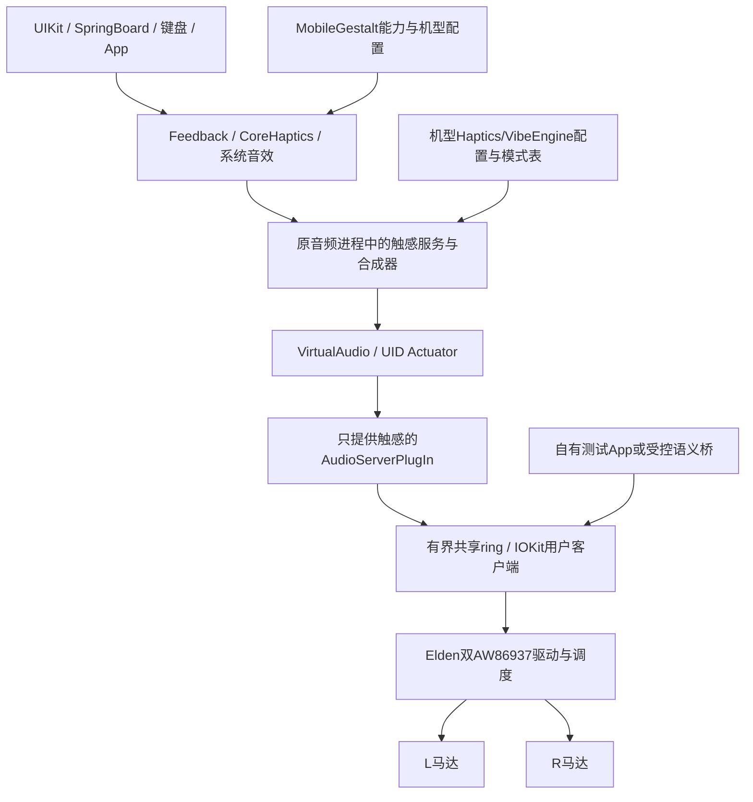

# Y700 双马达接入 iPadOS 17：可行性与实现交接

日期：2026-11-14。范围：离线探索和证据整理；没有编写/启用 XNU 马达驱动，
没有改 ADT、Plist、系统音频、启动镜像或设备设置，没有进行新的马达测试。
不占用正在进行的 Jerry 从零构建修复。师兄从本文和配套 evidence.json 接手即可。

## 结论与证据等级

**可行，但不只是“打开一个开关 + 加一个寄存器驱动”。** 分为三项不同成果：

1. **XNU 下让两颗马达各自播放原厂短点击：具备较强实现依据，尚未实现。**
   Android 两路 evdev 已分别驱动，用户确认左右交替和清脆 CLICK 都明显可感。
   板级资源、AW86937 Linux 实现和对应 RAM 波形已有固定来源。
2. **自己的 iPadOS 测试 App/服务请求点击：建议第一个用户态里程碑。**
   用自有、版本化的 IOKit 接口调用新驱动，不必先伪装 iPhone 或启用 CoreHaptics。
   这只证明我们的 App 可用，不代表系统键盘/开关会振。
3. **UIKit / SpringBoard / 键盘 / CoreHaptics 自然驱动马达：有明确研究路线，风险集中在用户态。**
   目标镜像已有框架、服务和效果资源，但机型能力、Actuator 音频路由、合成配置、
   反馈请求及底层执行必须同时成立。所查公开参考没有提供可直接套用到 Y700 的完整成功闭环。

通常 iPad 本体没有 iPhone 那类内置 Taptic Engine；这不意味着 iPadOS 没有触感软件栈。
Apple 文档列 CoreHaptics 支持 iPadOS，并要求通过 `capabilitiesForHardware().supportsHaptics`
查询实际能力。框架可用与本体有马达是不同条件；手柄/Pencil 的触感也不能当作机身马达通道。
不需要、也不建议为了此项把整个机型改成 iPhone；即使改机型，底层服务和校准仍不会自动出现。

## 已核本机硬件与波形

所有“L/R”是原厂驱动标签，物理左右会随握持方向变化。

| 资源 | L | R | 依据 |
| --- | --- | --- | --- |
| 驱动芯片 | AW86937 | AW86937 | Android `awinic_ic` 实读 |
| I²C 地址 | 0x5A | 0x5B | 实机 sysfs + 固定 Gen4 DTS |
| 输入设备 | aw-haptic-hv | aw-haptic-hv | 实机；event编号随重启变化 |
| SoC IRQ GPIO | 99，下降沿 | 95，下降沿 | Gen4 DTS，需上机核 OEM DT |
| Reset GPIO | 127，低有效 | 119，低有效 | Gen4 DTS，需上机核 OEM DT |
| 总线 | QUPv3 wrap1 SE6 / i2c6 | 同一条总线 | SM8750 DTS |
| GENI MMIO | 0x00A98000，长度0x4000 | 共用 | SM8750 DTS |
| SDA / SCL | GPIO56 / GPIO57，qup1_se6 | 共用 | SM8750 DTS |
| GENI IRQ | GIC SPI363（INTID395） | 共用 | 注意不是GPIO马达完成IRQ |
| 时钟 | GCC_QUPV3_WRAP1_S6_CLK | 共用 | 需接本机GCC/owner，不能复用BT UART14配置 |

SLA0815 是用户提供的马达本体型号线索，未独立核拆机标识/数据手册。AW86937 是驱动芯片，
两者不矛盾。不要据型号猜谐振频率、额定电压或照搬 iPhone / Pagani 的驱动幅值。

固件来源一致性已逐字摘要核验：

- ArmadaOS `885fd1fdaa373f266b9a3207997b91c67aa22e6d` 的
  `system_files/usr/lib/firmware/awinic/y700-gen4-haptic.bin`。
- TWRP device `c9c6a9f1287e5b416c3480c5fe06b23dc54c9ab8` 的
  `recovery/root/vendor/firmware/haptic_ram.bin`。
- 都为1436字节，SHA256 `84598d2a5130f7fe6bccba5cfbcafa1341d2d5bfe2f7d1361142cb78783ce79d`。
  大端16位累加校验正确，RAM base0x800，5条目录项。
  索引1范围0x815..0x993；索引4范围0xB9C..0xC28。
- 这证明两个参考资产相同，**本轮没有读取设备RAM/固件文件来确认当前加载内容完全一致**。
  XNU准入应核实际来源、完整摘要、目录/范围，并写后完整读回。

Android原厂库 `vendor.qti.hardware.vibratorOL.impl.so`（SHA256见evidence）中
`InputFFDevice::play`@0x94c8把Effect::CLICK(0)映射为RAM索引1，使用vendor的
FF_PERIODIC/FF_CUSTOM参数；`haptic.ko`的RAM单次路径会清第二段、loop=0并自然结束。
我们已用它测试“清脆点击”，gain64，用户确认成功。见
[Android测试工具](../tools/device/Y700-MOTOR-TEST.md)及源代码。

Linux `aw86927.c`虽名为86927，固定Gen4版本明确支持AW86937/芯片ID0x9370，
**不必另造整套寄存器定义**。但默认设备树选索引4，`play_sine()`是循环波形用于FF_RUMBLE，
不能直接当索引1短点击。AW8693x的STOP也不同：进入专用stop mode再发GO并等standby，
不可沿用86927的STOP位假定。其RAM加载器已有尺寸、校验、目录/地址边界和逐块读回检查。
原厂手动测试读到的`vmax=8500mV`是配置报告，**不是马达端实际电压或安全上限证明**；
固定Linux的AW8693x初始化则限制boost7V，必须把这处策略差异记录并按真实硬件核实。

## 21H461 原镜像独立检查

只读挂载并在结束时卸载项目内已有 OS.raw/SystemOS.raw；未再下载IPSW。
原始镜像SHA分别为 `d8808bea…edc9c` / `b4908cde…0414f`，完整值见evidence。
SystemVersion确认17.7.11/21H461；`ProductName=iPhone OS`是系统通用字段，不能据此认定装成iPhone。

| 本轮独立观察 | 意义与限制 |
| --- | --- |
| dyld缓存中真实CoreHaptics、Haptics、AudioToolboxCore、libMobileGestalt存在；symbols UUID匹配 | 软件组件在镜像里，不等于服务已正常工作 |
| CoreHaptics `AVHapticPlayer supportsHaptics`的once调用`ProductSupportsClosedLoopHaptics` | 仅开普通“有马达”标志未必开启CoreHaptics |
| 对应CFString实际是DeviceSupportsClosedLoopHaptics的混淆key；另有DeviceSupportsHaptics的key | 已与`base64(md5("MGCopyAnswer"+key))[:22]`对照 |
| MobileGestalt三个handler和属性混淆字符串与Pagani记录地址吻合 | 17版能力门的来源较强；未在Y700运行读取MG返回值 |
| 原audiomxd任务条件分支含`com.apple.audio.hapticd`、SystemSoundServer；mediaserverd另有条件后备 | 不要新造重名hapticd任务；先解析当前合并cache/feature flags及真实owner |
| J317和J120的SystemSoundVibrationPatterns.plist均55B，`Default={}` | 当前iPad机型的系统振动表为空 |
| 同一根卷D83表20577B、142个顶层键 | 本地已有iPhone语义模式参考，不需要先拉整套iPhone系统；不是直接移植校准 |
| Generic目录已有键盘、锁屏、接电等AHAP及音频资源 | 路径存在不保证震动；generic hapticengineconfig的所有层实际均为Audio |
| `/Library/Audio/Tunings`只有Generic/J120/J121/J207/J208等，无J317专用Haptics preset | runtime选用哪个product/fallback路径需诊断，不能硬填J120 |
| 现有冻结ADT是`model=iPad8,1`、`target-type=J317`，没有haptics节点 | 最新候选仍须核实际ADT及MGGetProductType；不直接用Pagani的J120 product64 |

独立锚点（均为此缓存未滑动VA，不是可跨版本使用的补丁地址）：

- CoreHaptics `ProductSupportsClosedLoopHaptics`@0x1B66241A4；
  `ProductSupportsHaptics`@0x1B664EA74；`CHDefaultHapticDeviceCapability supportsHaptics`@0x1B6639CE0。
- MobileGestalt相关handler：0x1A0229DD4（haptics节点），0x1A021F1A8（第三方属性存在），
  0x1A021D38C（closed-loop数值非零）。实际属性路径为IODeviceTree:/product/haptics。
- 属性混淆值：haptics=`6S9CvPHPtzHQqKudHSfsag`，supports-3rd-party-haptics=
  `OtnrTIhWBtyPo45BcApMTw`，closed-loop=`XKpK5v7PGzbe7igjloNBpQ`。
- 注意普通节点handler先传入IODeviceTree:/product，而Pagani注释概括为递归找节点；
  **不要推广成随便任何平面任意位置放一个haptics都有效**。按其已分析的/product/haptics路径实现并实测。

## 系统链路：必须一起解决的层次

Actuator链路是Pagani对这版系统的反向分析及实现参考，本轮未完整反汇编VirtualAudio，
更未证明Y700系统请求已走通；框图中的未实现部分不是完成状态。

**硬件服务ready后再发布能力**：`/product/haptics`、`supports-3rd-party-haptics=1`和
`closed-loop=1`是候选设备树属性，不是给应用Info.plist加UIRequiredDeviceCapabilities。
后者只是安装/筛选要求，不会创建硬件或事件通道。系统设置开关也只是偏好，不能代替驱动。
能力查询有once/cache，必须在首轮查询之前发布；只对测试种子做准确缓存失效，禁止粗暴清数据。

`closed-loop`是Apple软件功能契约，不能因为AW86937支持自动谐振就宣称兼容Apple完整闭环。
基本点击阶段不要暴露连续/高质量CoreHaptics能力。硬件无法执行的能力应返回不支持，
不能吞请求或“成功但没振”。

## 哪些作业值得借鉴

| 来源（固定版本见evidence） | 可复用内容 | 不能扩大为 |
| --- | --- | --- |
| ArmadaOS四代README → h0cheung6f97250e | 精确Gen4 DTS、AW86937驱动/RAM校验、STOP差异 | 五代TB323FU接线；三代TB321FU参数；所有控制都已在XNU成功 |
| 本机Android HAL/module + 已验证manual v4 | 每路执行、CLICK索引1、常量/单次区别、恢复语义 | 可把Linux .ko/evdev API直接链接XNU；8500mV是额定上限 |
| ShengAudio原架构 | 音频server插件、共享ring、时钟、生命周期的方法 | sheng已验证系统震动；本轮没找到sheng马达成功记录 |
| PaganiHaptics/HapticsIos + PaganiAudioHaptics | 能力门、Actuator UID、有界ring、时序/丢帧/限幅/停机原则 | 它的HAP530 SPMI驱动、7450/3600/1260mV、170Hz适用于Y700 |
| PaganiAudio对21H461的失败记录 | 先准备Actuator/preset，防VirtualAudio/MediaExperience卡初始化 | 其J120修复已完成系统触感；作者明确未见motor实际被用户态驱动 |
| gts7xlwifi官方设备索引 | “XNU马达可动”与“系统有请求”分离的实例 | 原生iPadOS所有触感已工作；索引仍要求后续接system haptics |

Pagani特别有用的失败经验：只加haptics节点就会等待Actuator；J120的
ActuatorSettingsFactory_Aspen产品表缺项可抛Invalid Product Type，被异常屏障吞掉，
导致音频路由一直没初始化。其绕过只绑定J120/product64和精确VirtualAudio UUID，
目前文档称host-tested。Y700是J317，必须先核它实际产品表和返回值，禁止改判断“全放行”。

## 推荐交付次序与验收

### H0：先固化输入，不刷机

确认正式构建系统能从Git和外部输入重建；本研究不打断Jerry复现任务。
准备Gen4 DTS/clock/GPIO、芯片ID、RAM镜像完整SHA、原厂校准来源；
`f0`/`lra_resistance`等sysfs读取可能触发测量流程，不能当普通静态字段随意批量读取。
核静态参数可读取项、owner和冷启动状态。每个马达独立保存/恢复，保持另一颗不动。

### H1：原生XNU驱动，只暴露自己的测试接口

- 建议组件`drivers/EldenHaptics`（尚不存在）：传输、AW86937状态机、双路策略分开。
  共用i2c6只有一套总线事务锁/owner；每颗独立芯片状态。不要每个实例都重置GENI。
- 现有`profiles/v91/sources/backlight/GeniI2c.*`可复用单寄存器/小块状态机方法，但其
  write最多8B/read最多4B，不能硬塞Linux16B SRAM块或RTP。按芯片自增/端口语义
  分块并完整读回，或扩展独立传输并验证；须核总线频率、FIFO和共享资源。
- 初始OFF→probe identity→stop/standby→受限配置→load RAM→full readback→ready，
  默认不播放；worker调度，IRQ不等待I²C。失败停止/撤回，不在UI调用里等总线。
- 第一发只读身份；第二发一次短CLICK L/R并自动stop，记录mode、seq/loop、完成、error。
  复用已经工作的串口/自动回程/完整boot SHA和floor准入。无需重复整晚随机探针。
- 能力仅`click`/bounded pulse/stop/status；上电、冷热启动、取消、并发、错误和恢复
  合并成一组有判定价值测试。首阶段gain限制参考已感觉成功的64并不高于已核原厂值，
  这只限定增益，不声称校准完成。任何保护/boost改动都须核本机证据。

### H2：原版iPadOS下自己的App触发点击

单独IOService/IOUserClient或沿现有受控端点提供版本化请求：
`GetCapabilities / PlayTransient(request_id, motor_mask, intensity) / Stop / GetStatus`。
校验调用者、长度、request_id、mask和幅度；成功返回含accepted/start/done层次，
不把排队成功当机械完成。进程死亡/超时自动取消；没有客户端时无忙轮询。
App上提供L/R/LRLRLR并逐条关联日志，保留Android对照；该阶段可不接音频、不发布haptics节点。

若只想先让某个UI动作有“哒”，可以在**真实已发生的语义反馈请求**处做小范围桥，
受版本/调用者限定并保留偏好；不要对每个触摸DOWN都振，这与iPhone反馈语义不同，
还会错误响应滚动、手掌和后台触点。也不要把整个UIKit/机器身份全局改成iPhone。

### H3：Actuator路由及系统调用，先诊断再开放能力

优先设计**只有触感输出的插件**，与扬声器/麦克风路径解耦；需要audio HAL不意味着
必须给物理扬声器上电。原有扬声器先讨论衰减和保护的约束继续有效。

Pagani参考的Actuator端口是48kHz单声道Float32、256帧IO周期；插件转成共享ring，
内核bridge整型处理并供底层FIFO。这些是候选ABI，须实查当前进程。
只支持RAM点击的H1还不满足此连续sample流契约：不能每收到一块就连发click并标完整CoreHaptics。
可以先用自有App的离散事件桥完成有限体验；要走原生Actuator必须实现下述H4的真实RTP，
或明确只接可证明的离散请求且不宣称连续支持。

原插件签名/trust/job/cache、内存owner、service匹配、单调时钟、音频时钟19.2MHz换算
需要按现有17构建流程接入。服务先可用，再在launchd/首个MG查询前准备能力节点；
检查J317实际配置路径、VirtualAudio产品项、Tunings fallback。Generic现有preset全部是
Audio层，不能复制它改名字就当有机械触感。原图形/输入/音频路由没有退化才进入下一步。

### H4：RTP/合成器与系统偏好

AW86937原厂存在RTP模式，但本研究没有验证其FIFO采样率、格式、供给门限/IRQ、
制动、幅度与电压关系；不能搬Pagani HAP530采样参数。需本机驱动/数据表和RAM测试
基础上完成非阻塞流、正确背压、欠载即停止、取消和总线故障。限幅/占空与thermal由
最内层强制执行，不能只依赖App。两路合计供电预算也要限制。

UIKit验收分别用selection/impact/notification；CoreHaptics先查真实capability，再试
一个transient、短continuous及stop/interruption。随后逐项验证键盘开关、锁屏、通知、
静音/勿扰/系统触感偏好。有些iPad UI根本不请求触感，需要精确语义适配；每项都单独
记录实际请求和波形开始，不承诺“开flag后一切和iPhone一致”。

## 两颗马达怎样给iPadOS呈现

普通手机反馈通常是一个逻辑机身actuator。建议系统先看到**一个逻辑设备**，驱动
策略选择L/R或校准后的双路；诊断接口保留显式motor_mask。不能把mono输入自动
等同立体触感或直接把FF_RUMBLE strong/weak当两颗物理马达。
默认双路同时全幅可能更响、更耗电，甚至通过机壳相互影响；是否双路、分担幅度、
横竖屏/左手右手策略由实测后决定。LRLRLR只是诊断模式，不应成为所有系统点击的默认。

## 下一位实现者的最短阅读清单

1. 本文、`tools/device/Y700-MOTOR-TEST.md`与实际`y700_motor_test.c`；
   用户确认的是Android真实机械响应，不是XNU。
2. `docs/evidence/haptics-feasibility-20261114.json`：Git来源、固件SHA/目录、OS与缓存
   UUID/SHA、空机型表、服务条件分支、Android日志摘要。
3. 固定Gen4 `aw86927.c` + DTS（链接见下）。先处理本机AW86937，别使用Pagani SPMI芯片代码。
4. Pagani `HapticsIos.h`、`PaganiAudioHaptics.*`、`hal/PaganiAudioPlugIn.c`和README的Limits。
5. 工作台 `lab/records/haptics-feasibility-20261114/{constants.json,support-gates.asm,apple-docs.json}`；
   完整Apple plist inventory留本地，不发布原始资源。Mach-O切片留edl_work和Mac lab，
   如需再次分析使用原镜像/缓存SHA，不能将text切片当完整可执行文件。

**本次未宣称的完成项**：XNU驱动、上电/IRQ/RTP、完整校准、UIKit真实反馈、系统键盘、
CoreHaptics连续效果、休眠、长期可靠性、双路同步与能耗。

## 固定来源与公共文档

- [Apple CoreHaptics](https://developer.apple.com/documentation/corehaptics)
  / [capabilitiesForHardware](https://developer.apple.com/documentation/corehaptics/chhapticengine/capabilitiesforhardware())
  / [UIFeedbackGenerator](https://developer.apple.com/documentation/uikit/uifeedbackgenerator)。
  当前公共文档用于API分层，不把新版本功能（例如新canvas反馈）默认当17已支持。
- [Gen4 DTS](https://github.com/h0cheung/tb322fc-linux-kernel/blob/6f97250ead155fc3b980856323e99a4623dae73d/arch/arm64/boot/dts/qcom/sm8750-lenovo-elden.dts#L1417)
  / [AW86927/37驱动](https://github.com/h0cheung/tb322fc-linux-kernel/blob/6f97250ead155fc3b980856323e99a4623dae73d/drivers/input/misc/aw86927.c)。
- [Armada四代来源说明](https://github.com/ArmadaOS-Freedom/armadaos-freedom/blob/885fd1fdaa373f266b9a3207997b91c67aa22e6d/devices/lenovo-tb322fc/README.md)。
  0208补丁源自五代、仅接受芯片ID，不足以代表四代完整init/固件实现；以固定Gen4全文为准。
- [PaganiHaptics](https://github.com/IssacL04/UniXNU-Pagani-Drivers/blob/c888efd3ce1b817d13f28783a77cf689cb2255c9/drivers/PaganiHaptics/README.md)
  / [PaganiAudio及失败边界](https://github.com/IssacL04/UniXNU-Pagani-Drivers/blob/c888efd3ce1b817d13f28783a77cf689cb2255c9/drivers/PaganiAudio/README.md)
  / [能力节点/配置overlay参考](https://github.com/IssacL04/UniXNU-Pagani_SM8750/blob/a84204eccb9b183945072e1b9b63de36c8495097/patches/xnu/phone-haptics-overlays.patch)。

引用驱动分别保留GPL-2.0-only或BSD标识；借鉴源码时按具体文件许可证处理。
固件、Apple原件、密钥与完整备份都作为外部输入，不随实现源码发布。
